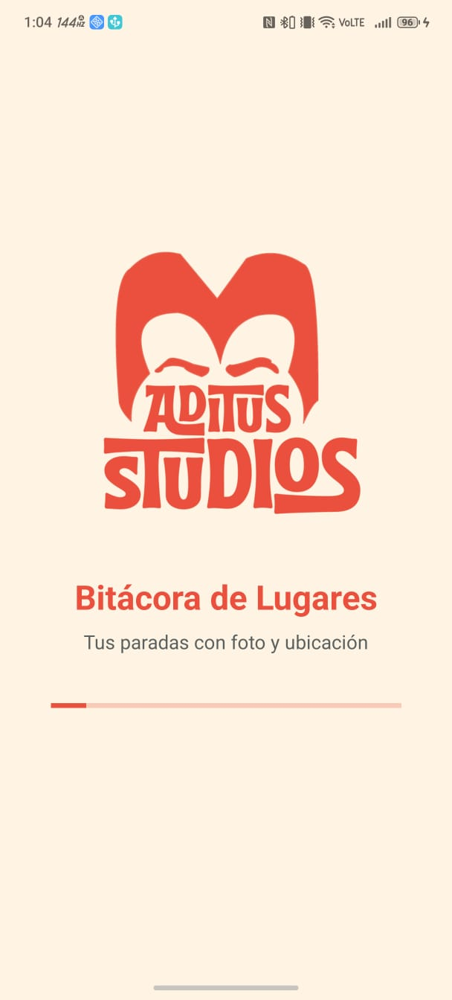
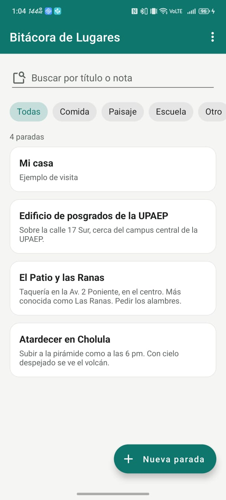
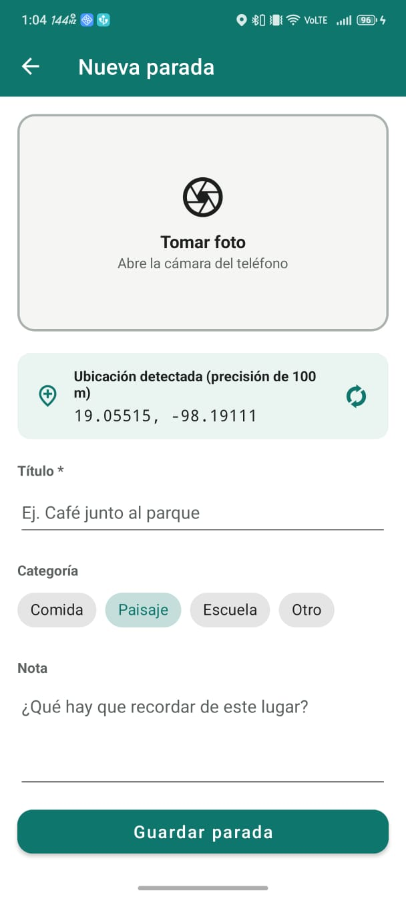
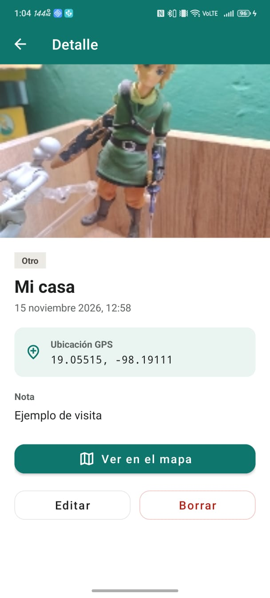
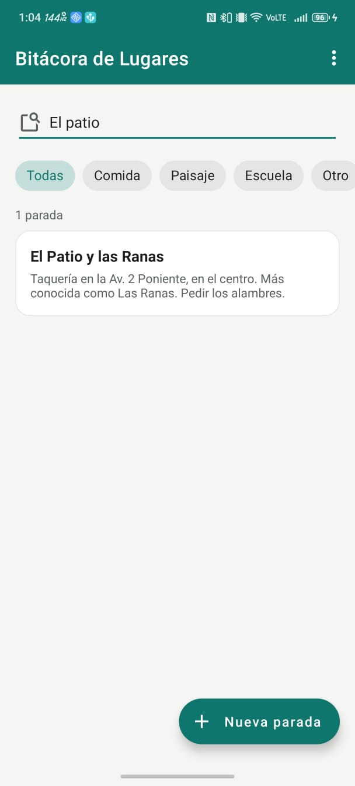
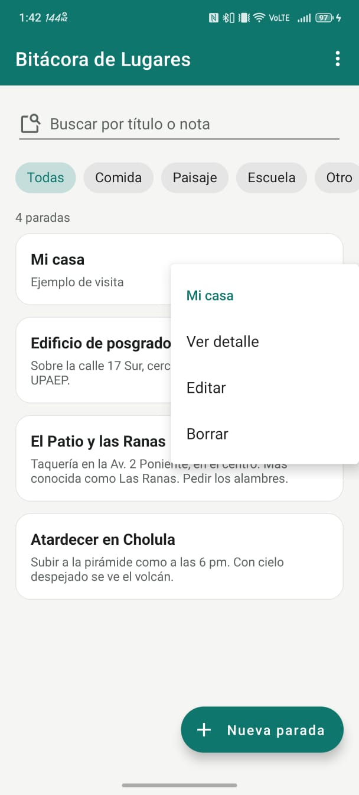
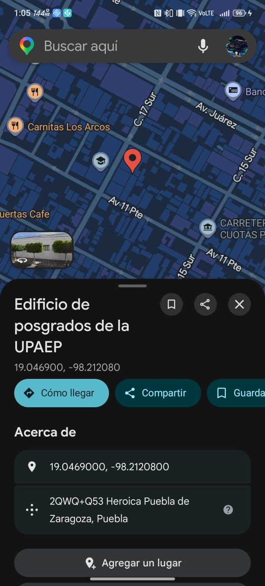

# Bitácora de Lugares

Aplicación para Android que guarda los lugares que visitas como "paradas", cada una con una foto tomada con la cámara, la ubicación obtenida con el GPS, una categoría, una nota y la fecha. Las paradas se guardan en el teléfono y se pueden buscar, filtrar, editar, borrar y abrir en el mapa para volver al lugar.

Proyecto final de **Programación de Dispositivos Móviles (ISW211)**, UPAEP.

## Integrantes

- Emilio Perea Montes
- Benito Abi Ramírez Vázquez

## Problema que atiende

Cuando visitamos un lugar que queremos recordar, tomamos una foto que termina perdida en la galería entre cientos de imágenes, sin saber dónde estaba el lugar ni por qué lo queríamos recordar. Las notas, si las hay, quedan en otra aplicación y sin ubicación.

Bitácora de Lugares junta en un solo registro **qué es** el lugar (título, categoría y nota), **cómo se ve** (la foto), **dónde está** (las coordenadas del GPS) y **cuándo** se visitó, y permite encontrarlo después y abrirlo en el mapa.

## Funcionalidades principales

- **Registrar paradas** con una foto tomada con la app de cámara del teléfono, ubicación automática del GPS (con su precisión en metros), título, categoría y nota. Antes de guardar se valida que haya título, foto y ubicación.
- **Lista de paradas** con el título y la nota de cada una, y un contador de paradas.
- **Búsqueda** por título o nota mientras se escribe, **filtro** por categoría y **orden** por fecha o por nombre (la app recuerda el orden elegido).
- **Detalle** de cada parada con la foto, la categoría con su color (Comida, Paisaje, Escuela u Otro), fecha y hora, coordenadas y nota.
- **Ver en el mapa:** abre la ubicación en Google Maps (u otra app de mapas) con un marcador.
- **Editar** una parada, incluso cambiar la foto o volver a detectar la ubicación, y **borrarla** con confirmación.
- **Menú contextual** al mantener presionada una parada (Ver detalle, Editar y Borrar) y menú de opciones con "Acerca de".
- **Pantalla de bienvenida** con el logo de Aditus Studios, música y barra de progreso.
- **Idiomas:** español, español de México, inglés y francés, según el idioma del teléfono.

## Evidencias visuales

| Bienvenida | Lista | Nueva parada | Detalle |
| --- | --- | --- | --- |
|  |  |  |  |

| Búsqueda y filtro | Menú contextual | Ver en el mapa |
| --- | --- | --- |
|  |  |  |

- **Prototipo de interfaz:** [docs/02_Prototipos](docs/02_Prototipos)
- **Diagrama de la base de datos:** [docs/03_Base_de_datos/Diagrama_BD_Bitacora.png](docs/03_Base_de_datos/Diagrama_BD_Bitacora.png)

## Cómo clonar, abrir, compilar y ejecutar

**Requisitos:**

- Android Studio (versión reciente), que ya incluye el SDK de Android y Gradle.
- Un teléfono Android con cámara y GPS, con las **Opciones de desarrollador** y la **Depuración USB** activadas, y su cable USB.
- Git, si se clona desde la terminal.

**Pasos:**

1. **Clonar el repositorio.** En Android Studio: **File → New → Project from Version Control**, pegar la URL del repositorio y presionar **Clone**. Desde la terminal:

   ```bash
   git clone https://github.com/emilioperea/Bitacora-de-Lugares-Emilio-Benito.git
   ```

   Si se clonó desde la terminal, abrirlo con **File → Open** y elegir la carpeta del proyecto.
2. **Esperar la sincronización de Gradle** (la barra de progreso de abajo). La primera vez descarga las dependencias y puede tardar unos minutos.
3. **Compilar:** **Build → Make Project**. Debe terminar sin errores.
4. **Conectar el teléfono** por USB y aceptar en el teléfono el aviso para permitir la depuración USB. El teléfono aparece arriba, en la lista de dispositivos.
5. **Ejecutar:** presionar **Run**. La app se instala y se abre en el teléfono.
6. **Primer uso:** al crear la primera parada, aceptar el permiso de ubicación (de preferencia "Precisa" y "Mientras la app esté en uso"). Conviene probar cerca de una ventana o al aire libre para que el GPS encuentre la señal más rápido.

La app incluye tres paradas de ejemplo (sin foto) para que la lista no empiece vacía.

## Tecnologías utilizadas

| Tecnología | Uso en el proyecto |
| --- | --- |
| Java y Android Studio | Lenguaje y entorno de desarrollo |
| Android SDK y AndroidX (AppCompat) | Actividades, vistas, menús, diálogos y compatibilidad entre versiones |
| Material Components | `MaterialToolbar`, `Chip`, `ExtendedFloatingActionButton` y `MaterialCardView` |
| SQLite (`SQLiteOpenHelper`, `ContentValues`, `Cursor`, `SimpleCursorAdapter`) | Base de datos local de las paradas y su lista |
| GPS (`LocationManager`, proveedores GPS y de red) | Obtener la ubicación de cada parada |
| Cámara (Intent `MediaStore.ACTION_IMAGE_CAPTURE`) | Abrir la app de cámara del teléfono y recibir la foto |
| `Bitmap`, `BitmapFactory` y `FileOutputStream` | Guardar la foto como archivo y volver a cargarla |
| Intents (`ACTION_VIEW` con `geo:`) | Abrir la ubicación en una app de mapas |
| `SharedPreferences` | Recordar el orden de la lista |
| Recursos de Android (`strings`, `values-en`, `values-fr`...) | Textos, colores, medidas, estilos e idiomas |
| Git y GitHub | Control de versiones y entrega |
| Figma | Prototipo de la interfaz |

**Permisos:** `ACCESS_FINE_LOCATION` y `ACCESS_COARSE_LOCATION`, que se piden mientras la app está en uso. La cámara se usa por medio de la app de cámara del teléfono, así que no necesita permiso propio, y las fotos se guardan en la carpeta privada de la app, sin permiso de almacenamiento.

## Cómo está construida

| Archivo | Responsabilidad |
| --- | --- |
| `SplashActivity.java` | Pantalla de bienvenida: música con `MediaPlayer` y barra de progreso con un `Thread` y un `Handler`; después abre `MainActivity` |
| `MainActivity.java` | Lista de paradas (`rawQuery` y `SimpleCursorAdapter`), búsqueda, filtros, menú de opciones, menú contextual y borrado |
| `FormularioActivity.java` | Crear y editar paradas: GPS, permisos, cámara, validación y guardado con `insert()` |
| `DetalleActivity.java` | Detalle de una parada, abrir el mapa, editar y borrar |
| `Parada.java` | Clase modelo con los datos de una parada, formato de fecha y colores de su categoría |
| `DatabaseHelper.java` | Acceso a SQLite: crear la tabla con datos de ejemplo, consultar una parada, actualizarla y borrarla |
| `UtilFotos.java` | Guardar la foto que regresa la cámara, cargarla y borrarla |

La navegación es: **Bienvenida → Lista → Nueva parada** (botón "Nueva parada") o **Detalle** (tocar una parada) **→ Editar** (desde el detalle o el menú contextual). Los datos pasan de una pantalla a otra con el `id` de la parada dentro del `Intent` (`putExtra` y `getLongExtra`), y cada pantalla vuelve a leer la base de datos en `onResume()` para mostrar siempre la información actual.

## Documentación

| Documento | Ubicación |
| --- | --- |
| Documento de requerimientos | [docs/01_Requerimientos.md](docs/01_Requerimientos.md) |
| Prototipos de interfaz | [docs/02_Prototipos](docs/02_Prototipos) |
| Modelo de base de datos (script, diagrama y explicación) | [docs/03_Base_de_datos](docs/03_Base_de_datos) |
| Código fuente | [app/src/main](app/src/main) |

## Fuentes y créditos

**Recursos usados en la aplicación**

- Pixabay. (2023, 10 de diciembre). *Intro* [Pista de música]. Pixabay. https://pixabay.com/es/music/pulsos-intro-180695/. Uso gratuito bajo la Licencia de Contenido de Pixabay (https://pixabay.com/en/service/license/).
- Google. (s. f.). *Material Icons* [Íconos]. Licencia Apache 2.0. Los íconos de la app se agregaron con Vector Asset Studio de Android Studio. https://developers.google.com/fonts/docs/material_icons
- Perea Montes, E. (2026). *Logo de Aditus Studios* [Imagen]. Elaboración propia.
- Perea Montes, E. (2026). *Ícono de la aplicación Bitácora de Lugares* [Imagen]. Elaboración propia.

**Documentación consultada** (formato APA 7; las páginas de Android Developers no tienen fecha de publicación y se consultaron entre el 9 y el 14 de noviembre de 2026)

- Android Developers. (s. f.). *Activity*. https://developer.android.com/reference/android/app/Activity
- Android Developers. (s. f.). *AlertDialog*. https://developer.android.com/reference/android/app/AlertDialog
- Android Developers. (s. f.). *Behavior changes: Apps targeting Android 15 or higher*. https://developer.android.com/about/versions/15/behavior-changes-15
- Android Developers. (s. f.). *Bitmap*. https://developer.android.com/reference/android/graphics/Bitmap
- Android Developers. (s. f.). *Cómo guardar datos simples con SharedPreferences*. https://developer.android.com/training/data-storage/shared-preferences
- Android Developers. (s. f.). *ContextCompat*. https://developer.android.com/reference/androidx/core/content/ContextCompat
- Android Developers. (s. f.). *Create app icons*. https://developer.android.com/studio/write/create-app-icons
- Android Developers. (s. f.). *Display content edge-to-edge in views*. https://developer.android.com/develop/ui/views/layout/edge-to-edge
- Android Developers. (s. f.). *Get a result from an activity*. https://developer.android.com/training/basics/intents/result
- Android Developers. (s. f.). *Google Maps intents for Android*. https://developer.android.com/guide/components/google-maps-intents
- Android Developers. (s. f.). *Localize your app*. https://developer.android.com/guide/topics/resources/localization
- Android Developers. (s. f.). *LocationManager*. https://developer.android.com/reference/android/location/LocationManager
- Android Developers. (s. f.). *MediaStore*. https://developer.android.com/reference/android/provider/MediaStore
- Android Developers. (s. f.). *Menus*. https://developer.android.com/guide/topics/ui/menus
- Android Developers. (s. f.). *Request location access at runtime*. https://developer.android.com/develop/sensors-and-location/location/permissions/runtime
- Android Developers. (s. f.). *Request runtime permissions*. https://developer.android.com/training/permissions/requesting
- Android Developers. (s. f.). *Save data using SQLite*. https://developer.android.com/training/data-storage/sqlite
- Android Developers. (s. f.). *Set up the app bar*. https://developer.android.com/training/appbar/setting-up
- Android Developers. (s. f.). *SimpleCursorAdapter*. https://developer.android.com/reference/android/widget/SimpleCursorAdapter
- Android Developers. (s. f.). *Take photos*. https://developer.android.com/media/camera/camera-deprecated/photobasics
- Android Developers. (s. f.). *TextWatcher*. https://developer.android.com/reference/android/text/TextWatcher
