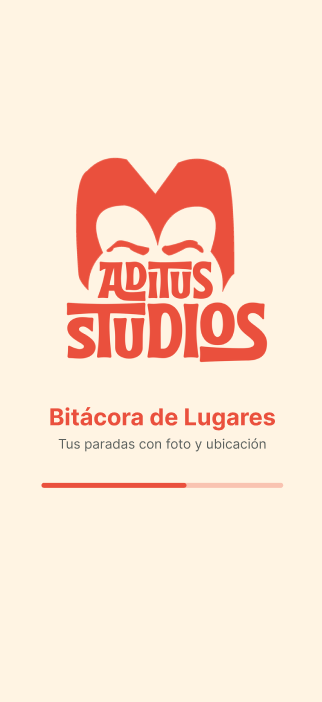
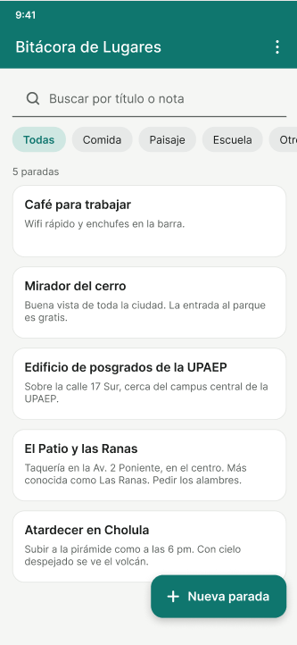
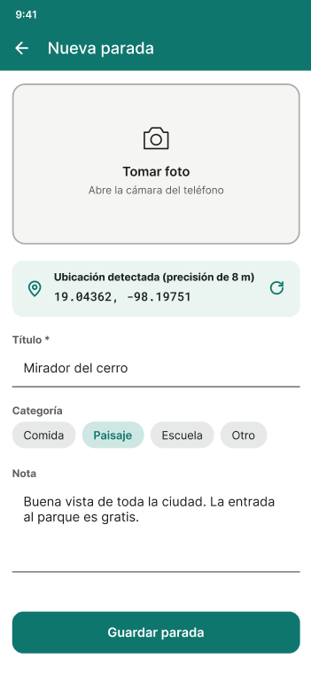
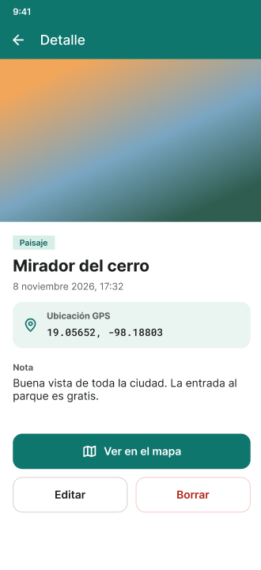
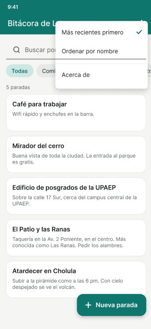
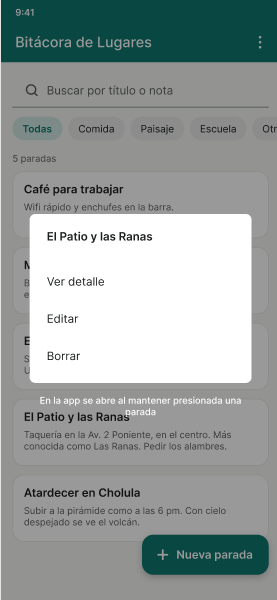
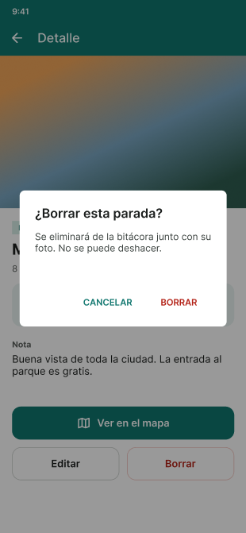

# Prototipos de interfaz: Bitácora de Lugares

**Proyecto final de Programación de Dispositivos Móviles (ISW211), UPAEP**
**Integrantes:** Emilio Perea Montes y Benito Abi Ramírez Vázquez

Prototipo interactivo en Figma: https://www.figma.com/design/j96lyIXkJllAjkalF58YCy

Para navegarlo, abrir el archivo, elegir el marco "1 Bienvenida" y presionar **Present** (el botón de Play, arriba a la derecha).

## Pantallas

| Pantalla | Qué muestra | Imagen |
| --- | --- | --- |
| 1 Bienvenida | Logo de Aditus Studios, nombre de la app y barra de progreso |  |
| 2 Lista de paradas | Búsqueda, filtros por categoría, contador, tarjetas de paradas y botón "Nueva parada" |  |
| 3 Nueva parada | Foto con la cámara, ubicación del GPS con su precisión, título, categoría y nota |  |
| 4 Detalle | Foto grande, categoría, fecha y hora, coordenadas, nota, "Ver en el mapa", Editar y Borrar |  |
| 5 Menú de opciones | Ordenar por fecha o por nombre y "Acerca de" |  |
| 6 Menú contextual | Ver detalle, Editar y Borrar al mantener presionada una parada |  |
| 7 Confirmar borrado | Diálogo para confirmar antes de borrar |  |

## Navegación

- **Bienvenida hacia Lista** (automático después de 2 segundos).
- **Lista hacia Nueva parada** con el botón "Nueva parada".
- **Lista hacia Detalle** al tocar una parada.
- **Lista hacia Menú contextual** al mantener presionada una parada; desde ahí a Detalle, Nueva parada (editar) o Confirmar borrado.
- **Lista hacia Menú de opciones** con el botón de tres puntos.
- **Detalle hacia Nueva parada** (Editar) o **Confirmar borrado** (Borrar).
- La flecha de regresar y "Guardar parada" vuelven a la Lista.
