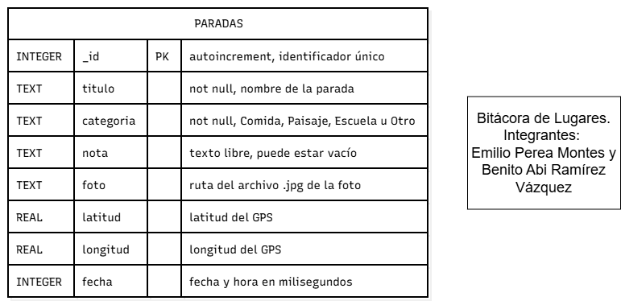

# Modelo de base de datos: Bitácora de Lugares

**Proyecto final de Programación de Dispositivos Móviles (ISW211)**
**Integrantes:** Emilio Perea Montes y Benito Abi Ramírez Vázquez

La aplicación guarda la información en tres lugares: una base de datos SQLite con una tabla `paradas`, una carpeta privada con las fotos y una preferencia con el orden de la lista. La base de datos es la fuente principal: cada parada es una fila, y la foto se relaciona con su fila por medio de la ruta del archivo.

Archivos de esta carpeta:

| Archivo | Contenido |
| --- | --- |
| `bitacora.sql` | Script del modelo: creación de la tabla, datos de ejemplo y las consultas que hace la app |
| `Diagrama_BD_Bitacora.png` | Diagrama del modelo de datos (ERD) |
| `Modelo_de_datos.md` | Esta explicación |

## Diccionario de datos

Base de datos `bitacora`, versión 1. Tabla `paradas`:

| Columna | Tipo | Restricción | Descripción |
| --- | --- | --- | --- |
| `_id` | INTEGER | PRIMARY KEY AUTOINCREMENT | Identificador único de la parada |
| `titulo` | TEXT | NOT NULL | Nombre de la parada, obligatorio en el formulario |
| `categoria` | TEXT | NOT NULL | `Comida`, `Paisaje`, `Escuela` u `Otro` |
| `nota` | TEXT | | Texto libre; queda vacío si el usuario no escribe nada |
| `foto` | TEXT | | Ruta del archivo .jpg de la foto |
| `latitud` | REAL | | Latitud obtenida del GPS |
| `longitud` | REAL | | Longitud obtenida del GPS |
| `fecha` | INTEGER | | Fecha y hora de registro en milisegundos desde el 1 de enero de 1970 |

La categoría se guarda siempre en español (las constantes `Parada.COMIDA`, `Parada.PAISAJE`, `Parada.ESCUELA` y `Parada.OTRO`), aunque el teléfono esté en otro idioma. Así el filtro y los colores funcionan igual en inglés, francés o español; solo el texto que ve el usuario se traduce con `strings.xml`.

## Cómo se almacena la información

- **La tabla.** La clase `DatabaseHelper` hereda de `SQLiteOpenHelper`. La primera vez que se abre la app, su método `onCreate()` crea la tabla `paradas` con `execSQL()` e inserta tres paradas de ejemplo con un `ContentValues` para que la lista no empiece vacía.
- **Una parada nueva.** `FormularioActivity` valida que haya título, foto y ubicación del GPS. Después pone cada dato en un `ContentValues` con `put()` y lo guarda con `getWritableDatabase().insert()`.
- **La foto.** No se guarda dentro de la base de datos. La app abre la app de cámara del teléfono con el Intent `MediaStore.ACTION_IMAGE_CAPTURE`, y la cámara regresa la foto como un `Bitmap`. La app la guarda como `parada_<fecha>.jpg` en su carpeta privada (`getFilesDir()`) con un `FileOutputStream`, y en la columna `foto` guarda solo la ruta. Esto mantiene la base de datos pequeña y rápida.
- **El orden de la lista.** Se guarda aparte, en `SharedPreferences` (archivo `Preferencias`, clave `ordenPorNombre`), porque es una preferencia del usuario y no un dato de las paradas.

## Cómo se consulta

- **La lista.** `MainActivity` hace un `rawQuery()` con `SELECT _id, titulo, nota FROM paradas` y el resultado llega en un `Cursor`:
  - Búsqueda: `WHERE (titulo LIKE ? OR nota LIKE ?)`, con el texto entre `%`.
  - Filtro: si hay una categoría elegida, agrega `AND categoria = ?`.
  - Orden: `ORDER BY fecha DESC` (más recientes primero) u `ORDER BY titulo` (por nombre).
- **Del Cursor a la lista.** Un `SimpleCursorAdapter` conecta el `Cursor` con la lista: la columna `titulo` va al `TextView` `txtTituloParada` y la columna `nota` a `txtNotaParada` del layout `row_parada.xml`. El adaptador entrega el `_id` de cada fila, que se usa para abrir el detalle, editar o borrar.
- **El detalle o el formulario de edición.** `obtenParada(id)` busca una sola fila con `_id = ?`, se coloca en ella con `moveToFirst()` y crea un objeto `Parada` con `getString()`, `getDouble()` y `getLong()`.
- **Cuándo se consulta.** La pantalla principal vuelve a consultar en `onResume()`, al escribir en la búsqueda y al cambiar el filtro o el orden. Así siempre muestra los datos actuales después de crear, editar o borrar.

## Cómo se actualiza

- **Editar.** `actualizaParada()` hace un `update()` de todas las columnas con `_id = ?`. Si el usuario tomó una foto nueva, primero se borra el archivo de la foto anterior.
- **Borrar.** Desde el detalle o desde el menú contextual de la lista, después de confirmar en un diálogo, `borraParada()` hace un `delete()` con `_id = ?`, y `UtilFotos.borraFoto()` elimina el archivo de la foto para no dejar archivos sueltos.
- **Cambios de versión.** Si en el futuro cambia la estructura de la tabla, se aumenta el número de versión que recibe el constructor (`super(context, DATABASE_NAME, null, 1)`) y `onUpgrade()` avisa en el Log y vuelve a crear la tabla.

En las consultas, los valores que escribe el usuario se pasan como argumentos (`?`) y no se pegan directo en el texto SQL. Así un título con comillas o caracteres especiales no rompe la consulta.

## Persistencia

Los datos se conservan aunque se cierre la app o se reinicie el teléfono. Se borran solo si el usuario borra una parada o si desinstala la aplicación, porque la base de datos y las fotos están en la carpeta privada de la app.
